<div align="center">
  
</div>

---

### 🩺 Prontuário

```csharp
var victor = new Developer
{
    Name        = "Victor Kulessa",
    Role        = "Software Engineer @ HCFMUSP",
    Stack       = new[] { "C#", ".NET", "ASP.NET Core", "EF Core", "React", "Next.js" },
    Data        = new[] { "SQL Server", "Oracle", "PostgreSQL" },
    Principles  = new[] { "Clean Architecture", "DDD", "SOLID" },
    Interests   = new[] { "Health Tech", "Interoperabilidade (FHIR)" },
    Education   = "Pós em Arquitetura de Sistemas .NET — FIAP",
    Location    = "São Paulo, Brasil 🇧🇷",
    Website     = "victor.kulessa.com.br"
};
```

---

### 💊 Stack

**Back-end**


**Front-end**


**Banco de dados**


**Cloud & DevOps**


---

### 📈 Sinais vitais

<div align="center">
  
  
</div>

---

### 📋 Projetos

#### [🏥 Conferi](https://github.com/vkhydra/conferi)
> Confere a conta da internação **antes** de enviar ao SUS: valida a AIH contra a tabela SIGTAP e aponta o que seria glosado.

| | |
|---|---|
| **Stack** | C# · .NET 10 · ASP.NET Core Minimal API · xUnit |
| **Arquitetura** | Clean Architecture, domínio na linguagem do SUS |
| **Destaques** | Leitor do SIGTAP (largura fixa, Latin-1) · Regras independentes e testáveis · Download automático da tabela |

#### [📟 Portfolio](https://victor.kulessa.com.br)
> Meu portfolio em forma de terminal de monitor hospitalar, em PT / EN / ES.

| | |
|---|---|
| **Stack** | Astro · TypeScript |
| **Destaques** | Terminal interativo · Faixa de ECG animada · i18n |

#### [💸 FinanceBot](https://github.com/vkhydra/FinanceBot)
> Bot de controle financeiro pessoal integrado ao Telegram, com API REST, front-end web e arquitetura limpa.

| | |
|---|---|
| **Stack** | C# · .NET · ASP.NET Core · Docker · PostgreSQL |
| **Arquitetura** | Clean Architecture (Api / Application / Domain / Infrastructure) |
| **Destaques** | Telegram Worker · Testes automatizados · Docker Compose · Front-end web |

---

### 📟 Encaminhamento

<div align="center">

[](https://victor.kulessa.com.br)
[](https://www.linkedin.com/in/victor-kulessa/)
[](mailto:victor.kulessa@outlook.com)
[](https://discordapp.com/users/401110489083543572)

</div>
